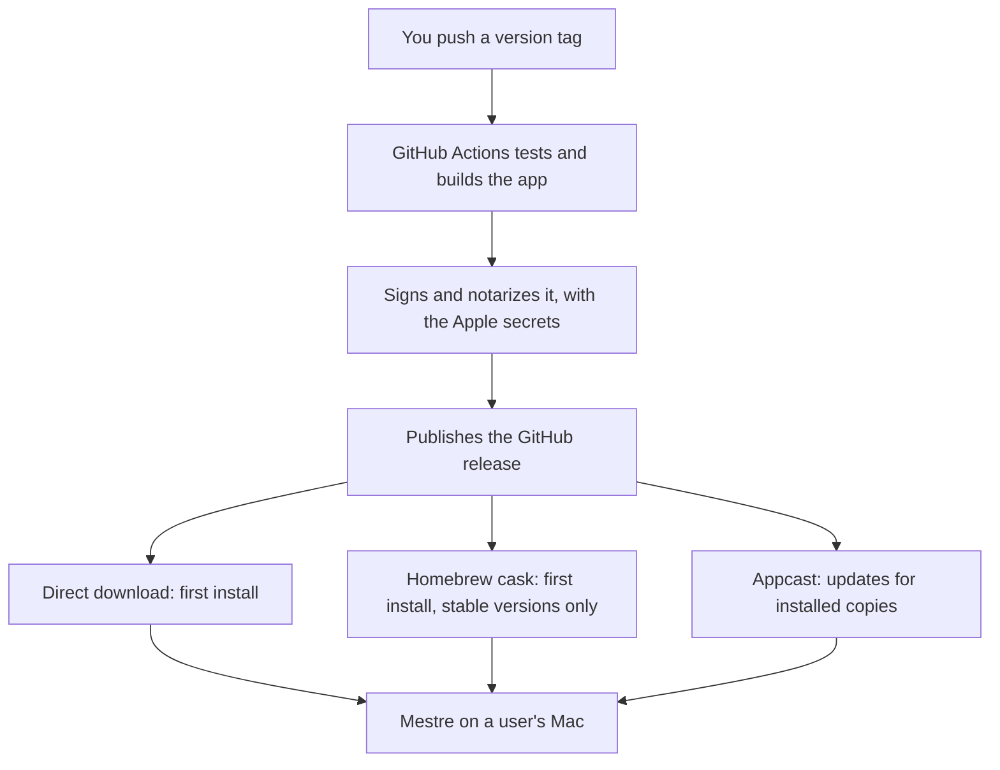
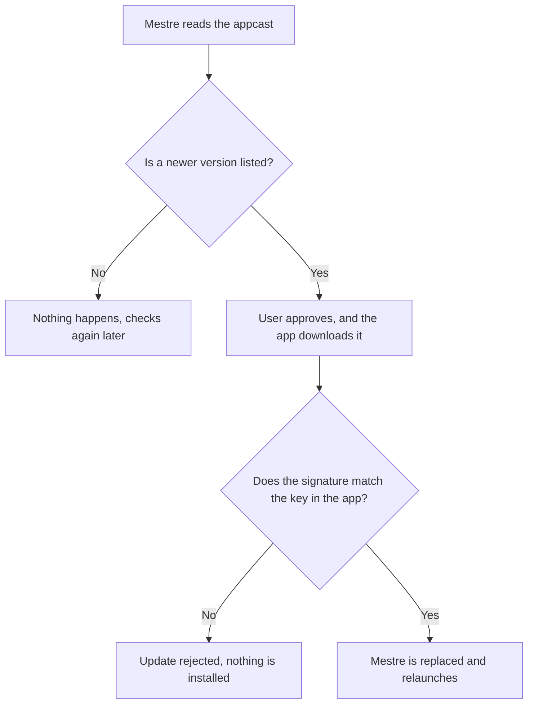

# Releasing

A git tag sets the version. You create the tag, and GitHub Actions does the rest.

## Ship a version

From an up-to-date `master` with a clean working tree:

```bash
make release
```

It suggests a version from the commits since the last stable tag, lets you type another one, asks
you to confirm, then pushes the tag. To choose the version up front:

```bash
make release VERSION=0.3.0-beta.1
```

The push starts [release.yml](../.github/workflows/release.yml), which tests, builds, signs,
notarizes and publishes the GitHub release, then updates the appcast and the Homebrew cask.
Follow it with `gh run watch`.



Sparkle's update check runs on each installed copy, once a day by default:



## How versions work

| Since the last stable tag | Suggestion |
| --- | --- |
| `fix:` or `perf:` | Patch: `0.2.0` → `0.2.1` |
| `feat:` | Minor: `0.2.0` → `0.3.0` |
| `feat!:`, or a `BREAKING CHANGE:` footer | Major: `1.2.0` → `2.0.0` |
| Anything else | No release suggested |

- Below 1.0 a breaking change bumps the minor version. Moving to `1.0.0` is a choice, made by typing it.
- Removing a config key, or changing what one means, is a breaking change.
- `CFBundleShortVersionString` comes from the tag. `CFBundleVersion`, which Sparkle compares, is the
  number of commits on `master`, so it only goes up.
- A tag with a suffix, such as `v0.3.0-beta.1`, is a pre-release: it reaches only the people on the
  `beta` channel (`updates.channel`) and skips Homebrew.
- Local builds report `0.0.0-dev` and have no update key, so Sparkle stays off.

## Release stages

- **Public beta:** normal `0.x` versions such as `v0.1.0`, with the README saying Mestre is in beta.
  They reach everyone, because new installs start on the `stable` channel.
- **Pre-release tags:** only for testing something risky before people get it, such as the first
  release or the first signed build. Someone on the `stable` channel never gets these updates.
- **`1.0.0`:** when the config format is stable. Remove the beta line from the README then.

## Rules

- Tags are never moved or deleted. If a release is bad, fix it and ship the next patch version. A
  ruleset on `v*` tags enforces this.
- Only commits on `master` can be released. The workflow fails on any other tag.
- If a release run fails, re-run it in GitHub Actions. Every step is safe to repeat: it replaces the
  download and updates the appcast and cask entries for that version.
- A release fails straight away if only one of the two Sparkle keys is set.

## One-time setup

Add these under Settings › Secrets and variables › Actions. Each group turns on one part of the
workflow, and a release still publishes without them.

### Sparkle updates

Do this before the first release: a build made without the public key can never update itself.

```bash
.build/artifacts/sparkle/Sparkle/bin/generate_keys
```

```bash
.build/artifacts/sparkle/Sparkle/bin/generate_keys -x ~/sparkle-private.key
```

The first command stores the private key in your login Keychain and prints the public key. The
second exports the private key outside the repo, so it can't get committed. Back it up, add it as
the secret, then delete the file. Installed copies can only verify updates signed with this key.

| Name | Kind | Value |
| --- | --- | --- |
| `SPARKLE_PUBLIC_KEY` | Variable | The public key |
| `SPARKLE_PRIVATE_KEY` | Secret | The private key |

### Self-signed certificate

macOS ties permissions like Accessibility to how an app is signed. An ad-hoc build is identified only
by a fingerprint, which changes every release, so an update silently breaks the permission. Sign with
one certificate and it stays. Do this before the first public release:

```bash
scripts/make-signing-cert.sh
```

It creates the certificate, adds it to GitHub as `SIGNING_CERTIFICATE_BASE64` and
`SIGNING_CERTIFICATE_PASSWORD`, and leaves two files in your home folder. Save both in your password
manager, then delete them. If you lose them, a new certificate works, but everyone has to grant
permissions once more. People still see the first-launch warning, since Apple doesn't vouch for it.

### Apple signing and notarization

These need an Apple Developer account, and they take over from the self-signed certificate. They
remove the first-launch warning, and they show your legal name on the signature. People have to grant
permissions once more when you switch.

| Secret | Value |
| --- | --- |
| `APPLE_CERTIFICATE_BASE64` | Developer ID Application certificate as a `.p12`, base64 encoded |
| `APPLE_CERTIFICATE_PASSWORD` | The `.p12` password |
| `APPLE_SIGNING_IDENTITY` | `Developer ID Application: Your Name (TEAMID)` |
| `APPLE_ID` | Your Apple account email |
| `APPLE_TEAM_ID` | Your team ID |
| `APPLE_APP_PASSWORD` | An app-specific password for that account |

### Homebrew

Create a public `fabioop/homebrew-tap` repository, and a fine-grained token with write access to its
contents. Store the token as the `HOMEBREW_TAP_TOKEN` secret. People then install with:

```bash
brew install --cask fabioop/tap/mestre
```

## Limits

- Self-signed releases run without the hardened runtime, so malware already on a Mac could inject code
  into Mestre and use its permissions. macOS refuses to load Sparkle under that runtime without an Apple
  team ID, and `v0.1.0-beta.4` didn't launch because of it. A Developer ID fixes this. CI can't catch
  it: the same kind of build launched fine there, probably because its machines don't enforce library validation.
- Releases are Apple silicon only, since `swift build` makes a single-architecture binary here.
- Mestre is a menu-bar app, and it doesn't use Sparkle's gentle reminders yet, so Sparkle logs a warning
  about scheduled update prompts. The prompt window may open behind other apps.
